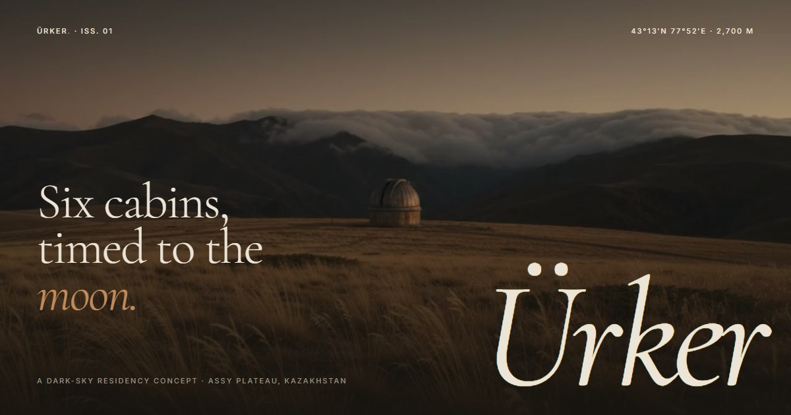

# Ürker

**Six cabins, timed to the moon.** A cinematic, scroll-driven site for a fictional dark-sky residency on the Assy plateau above Almaty, at 2,700 m.

**Live:** https://urker.vercel.app



> Ürker (Үркер) is the Kazakh name for the Pleiades. This is a design concept, not a business, and it is not affiliated with the Fesenkov Astrophysical Institute, which runs the real Assy-Turgen observatory. The footage and stills were generated for the concept. The sky data is real.

## What is real here

The site is a motion piece, but everything that looks like data is computed in the browser:

| | |
|---|---|
| Live ephemeris | Sun altitude, the countdown to astronomical dusk (or dawn), and moon illumination and phase for 43.225° N, 77.871° E, updated every second. |
| Tonight | A noon-to-noon chart of sun and moon altitude in 10-minute steps. Scrolling moves a cursor through the night, and the clock, sky state and altitudes follow it. Bands mark the hours that are truly dark: sun below −18° and moon below the horizon. |
| Nights, by moon | A 42-night calendar where the moon sets price and availability. Under 25% illuminated is a *Dark night* (premium), over 75% is a *Moonlight walk*, and anything between is *Half-light*. Each night shows its real dark window and how long it lasts. Occupancy is simulated with a stable hash, because there is no booking backend. |
| Wind | A steppe wind synthesised with the Web Audio API: band-passed noise with slow gust oscillators over a low open fifth. No audio file is downloaded. |

[`src/lib/astro.ts`](src/lib/astro.ts) is a low-precision solar and lunar ephemeris (Meeus, after the public-domain SunCalc formulas). Crossings such as dusk are found by a 5-minute scan and then bisection to the second. [`src/lib/nights.ts`](src/lib/nights.ts) builds the lunar calendar on top of it. Tests pin known events: the 2026 solstice noon altitude, the full moon of 24 Nov 2026, the new moon of 9 Dec 2026, and the dusk time and dark-window length on those nights.

## Motion

- **Hero:** a seamless looping video. Line-masked headline and wordmark reveal on load, and the footage scales and dims on scroll.
- **Manifesto:** a word-by-word reveal tied to scroll position.
- **Tonight:** a sticky stage over a star-field loop. The sun and moon curves draw themselves as you scroll.
- **The dome:** the video is scrubbed by scroll. The playhead follows the scroll position with per-frame easing, so the shutter opens as you move. The clip is encoded with a keyframe every 4 frames so that scrubbing backwards stays smooth.
- **Cabins and walk:** parallax frames, a scale-down reveal and staggered lists.
- Smooth scrolling comes from Lenis. With `prefers-reduced-motion`, smooth scrolling, loops and grain are off and the scrubbed clip rests on its open frame.

## Media pipeline

[`scripts/media.mjs`](scripts/media.mjs) turns the raw generated clips and stills into web assets:

- It crops the generator's rounded film frame from the hero clip.
- It builds seamless loops by cross-fading each clip's tail into its head, so the last frame equals the first (34 dB PSNR at the seam).
- It strips audio and encodes H.264 and VP9. The hero loop is 438 KB as WebM.
- It encodes stills as AVIF and WebP at 960, 1600 and 2400 px.

## Stack

React 19 · Vite · TypeScript · motion · Lenis · Vitest. Cormorant Garamond, Inter and JetBrains Mono, all self-hosted.

## Run

```bash
npm install
npm run dev        # http://localhost:5173
npm test
npm run build
npm run media      # rebuild public/media from source/ (needs the raw clips)
```

## Licence

Code MIT. The imagery and footage are part of the concept and are not licensed for reuse.
